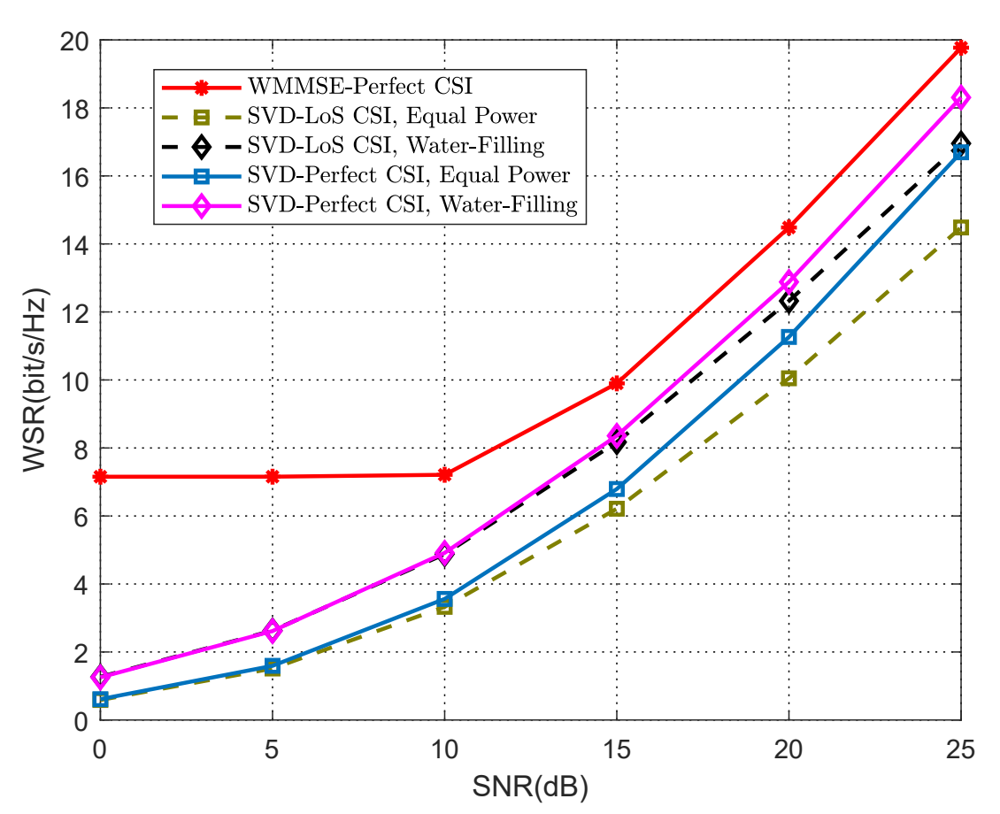

# 多用户 MIMO-OTFS 下行预编码仿真

本项目为MIMO-OTFS系统的低复杂度加权和速率（WSR）优化方法。实验对应参考论文图 3：在相同的多径信道上，比较 WMMSE 基线与四种 SVD 预编码方案，观察信噪比从 0 dB 增至 25 dB 时的速率变化。

参考论文为 Hailong Liang、Qin Tao、Ben Wang 和 Zhaoyang Zhang 的 *Weighted Sum Rate Maximization for Multi-User MIMO-OTFS Systems over High-Mobility Scenarios*，IEEE Journal of Selected Topics in Signal Processing，2026。第 II 节给出信道模型，第 III 节介绍 WMMSE 和基于主导视距径（LoS）的 SVD 预编码，第 IV 节给出数值实验。[随项目附带的论文 PDF](./Weighted_Sum_Rate_Maximization_for_Multi-User_MIMO-OTFS_Systems_over_High-Mobility_Scenarios.pdf) · [DOI](https://doi.org/10.1109/JSTSP.2026.3700518)

## 项目架构

从 [main.m](./main.m) 开始阅读。每次蒙特卡洛迭代先为各用户生成多径信道，再把同一组信道交给五种预编码方案，在各个 SNR 点计算加权和速率。最后，`main.m` 将速率除以 OTFS 格点数 `M*N`，对各次信道实现取平均并绘图。

| 文件或目录 | 在项目中的作用 |
| --- | --- |
| [main.m](./main.m) | 设置天线数、网格大小、SNR 和仿真次数，构造近似与完整 CSI 两种 SVD 模型，调用算法并汇总结果。 |
| [channel_generation.m](./channel_generation.m) | 生成各用户的完整信道矩阵 `H`，同时返回首径的发射方向和复增益，供近似 CSI 方案使用。 |
| [steeringVec.m](./steeringVec.m) | 计算均匀线阵的导向矢量，供信道生成和首径近似模型共用。 |
| [functions/](./functions/) | 实现 WMMSE 和四种 SVD 预编码方案，以及迭代更新、功率分配和速率评估所需的辅助函数。 |
| [sum_rate.m](./sum_rate.m) | 在完整信道上计入用户间干扰和噪声，计算各用户速率并按用户权重求和。五种方案共用此函数。 |
| [figures/](./figures/) | 存放参考论文的图 1 至图 6，包括系统模型、收发机结构和实验结果。 |

### functions/ 中的函数

**WMMSE** 的入口是 `wmmse_rate.m`。每轮迭代依次更新接收滤波器、误差权重和发射预编码，再调用根目录的 `sum_rate.m` 检查速率变化。

| 文件 | 作用 |
| --- | --- |
| [wmmse_rate.m](./functions/wmmse_rate.m) | 初始化各用户的预编码矩阵，控制迭代，并按相对速率变化或迭代次数上限终止。 |
| [find_U.m](./functions/find_U.m) | 根据当前预编码、信道和噪声协方差，求各用户的线性 MMSE 接收滤波器 `U`。 |
| [find_W.m](./functions/find_W.m) | 根据接收滤波器和预编码计算估计误差协方差，取其逆得到误差权重矩阵 `W`。 |
| [find_V_complexity.m](./functions/find_V_complexity.m) | 在每个基站的发射功率预算下，用二分法搜索对偶变量并更新预编码矩阵 `V`。 |

**SVD** 有四个入口。文件名中的 `approx` 和 `perfect` 区分用于设计预编码器的信道信息，`equal` 和 `waterfill` 区分功率分配方式。

| 用于预编码的信道信息 | 等功率 | 注水 |
| --- | --- | --- |
| 近似 CSI，使用首径构造的模式 | [svd_approx_equal_rate.m](./functions/svd_approx_equal_rate.m) | [svd_approx_waterfill_rate.m](./functions/svd_approx_waterfill_rate.m) |
| 完整 CSI，使用完整信道的右奇异向量 | [svd_perfect_equal_rate.m](./functions/svd_perfect_equal_rate.m) | [svd_perfect_waterfill_rate.m](./functions/svd_perfect_waterfill_rate.m) |

两种注水方案调用 [waterfill_impove.m](./functions/waterfill_impove.m)，按模式增益和功率权重分配发射功率。四种 SVD 方案都调用 [svd_precoder_rate.m](./functions/svd_precoder_rate.m)，将预编码矩阵按用户拆分，再交给根目录的 `sum_rate.m` 计算加权和速率。

## 图 3 实验结果



图取自参考论文第 8 页，曲线为论文作者对 200 次蒙特卡洛仿真取平均的结果。在 0 至 25 dB 的六个 SNR 点上，WMMSE 的平均加权和速率均最高。在 25 dB 处，完整 CSI 配合注水的 SVD 方案最接近 WMMSE。论文为每个用户固定使用 5 条路径，本项目默认按用户随机抽取 1 至 5 条路径。[论文原图](./Weighted_Sum_Rate_Maximization_for_Multi-User_MIMO-OTFS_Systems_over_High-Mobility_Scenarios.pdf#page=8)

## 运行

在装有 Signal Processing Toolbox 和 Symbolic Math Toolbox 的 MATLAB 中，将当前文件夹切换到仓库根目录（可以看到 `main.m` 和 `functions/`）。在命令窗口运行以下命令。如果希望多次运行使用同一组随机信道，可先执行 `rng(1, 'twister')`。

```matlab
main
```

脚本默认生成 200 次随机信道实现（`Mont = 200`），在每次实现上依次计算 0、5、10、15、20、25 dB 下的加权和速率。运行结束后，图窗会显示五种预编码方案在各个 SNR 点的平均速率（bit/s/Hz）。

各方案的逐次结果保存在 MATLAB 工作区的 `200 × 6` 矩阵中，每行对应一次信道实现，每列对应一个 SNR 点。例如，运行以下命令可查看 WMMSE 曲线上六个点的数值，每行依次列出 SNR（dB）和平均加权和速率（bit/s/Hz）。

```matlab
[Snr(:), mean(Rate_SMMSE, 1).']
```

## 五条曲线怎么读

CSI 指发射端设计预编码器时掌握的信道信息。每轮实验先生成一次完整信道，再用各用户首径的发射方向和复增益构造近似 SVD 模型，并对完整信道做 SVD 得到另一组模型。两组模型都供该轮所有 SNR 点复用。五种方案最终都在同一个完整信道上评价用户间干扰和速率。[信道生成](./channel_generation.m) · [阵列导向矢量](./steeringVec.m) · [加权和速率计算](./sum_rate.m)

| 图中方案 | 每个用户的预编码设计 | 工作区结果矩阵 | 实现入口 |
| --- | --- | --- | --- |
| WMMSE · 完整 CSI | 交替更新接收滤波器、误差权重和发射预编码 | `Rate_SMMSE` | [wmmse_rate.m](./functions/wmmse_rate.m) |
| SVD · 近似 CSI · 等功率 | 从首径构造解析基，对各模式采用相同幅度系数 | `Rate_SVD_my` | [svd_approx_equal_rate.m](./functions/svd_approx_equal_rate.m) |
| SVD · 近似 CSI · 注水 | 使用首径解析基，按模式增益和功率权重分配功率 | `Rate_SVD_my_ww` | [svd_approx_waterfill_rate.m](./functions/svd_approx_waterfill_rate.m) |
| SVD · 完整 CSI · 等功率 | 取完整信道的前 `M*N` 个右奇异向量，对各模式采用相同幅度系数 | `Rate_SVD_traditional` | [svd_perfect_equal_rate.m](./functions/svd_perfect_equal_rate.m) |
| SVD · 完整 CSI · 注水 | 使用完整信道的上述奇异模式，按模式增益和功率权重分配功率 | `Rate_SVD_traditional_wp` | [svd_perfect_waterfill_rate.m](./functions/svd_perfect_waterfill_rate.m) |

阅读论文算法 1 时，可从 `wmmse_rate.m` 跟进 `find_U.m`、`find_W.m` 和 `find_V_complexity.m`。阅读算法 2 时，可先看 `main.m` 中的 `approxModel`，再看近似 CSI 注水入口如何构造预编码矩阵。两种注水方案共用同一个功率分配函数。[加权注水实现](./functions/waterfill_impove.m)

## 默认仿真参数

默认场景为单基站（`K = 1`）服务 4 个用户（`I = 4`）。基站配备 16 根发射天线，每个用户配备 4 根接收天线，时延–多普勒网格为 `8 × 8`。用户权重均为 1，噪声功率 `sigma2 = 1`，脚本按 `P = 10^(SNR_dB/10)` 设置发射功率预算。

默认 WMMSE 为每个用户配置 `d = N_R*M*N = 256` 条数据流，相对速率变化阈值为 `1e-3`，最多迭代 100 次。四种 SVD 方案为每个用户保留 `M*N = 64` 个模式。

每个用户在运行开始时随机抽取 1 至 5 条路径，并在 `Mont = 200` 次信道实现中沿用该路径数。每轮重新抽取路径增益、方向、时延和多普勒。非视距径的平均功率为 0.01，整数时延取 0 至 10，归一化多普勒取值范围为 [0, 2)。
